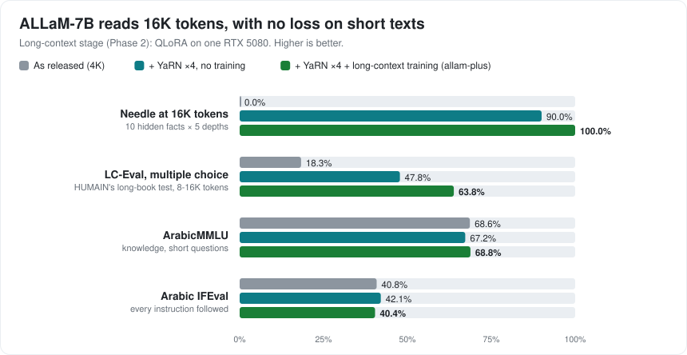

# allam-plus

Upgrading HUMAIN's open **ALLaM-7B-Instruct** for real Arabic applications, on one 16 GB gaming GPU, with every
change measured against the untouched model:

1. **Long context**: 4K → 16K tokens (YaRN + a short long-text training stage).
2. **Arabic tool calling**: general tools, Modern Standard Arabic and Saudi dialect.
3. **Agent-ready serving**: an OpenAI-compatible server that returns standard `tool_calls` (LangGraph and others).
4. **Fast quantised releases**: GGUF 4/8-bit with a speed and memory table.
5. **No loss of Arabic quality**: ArabicMMLU and Arabic IFEval before and after.

**Status:** Phases 1–4 done; nothing published yet. **ALLaM-7B now reads 16K tokens (4× its original 4K) and calls
tools in Arabic, with no loss on general Arabic tasks, and serves standard `tool_calls` from a single GGUF file**, all
trained on one RTX 5080.

| | As released | **allam-plus** | allam-plus, Q4_K_M GGUF served |
|---|---|---|---|
| Needle at 16K tokens | 0% | **100%** | 100% |
| LC-Eval (HUMAIN), multiple choice on 8–16K-token books | 18.3% | **66.1%** | |
| ArabFuncBench, right tool / every argument right | 65.9% / 19.0% | **96.0% / 47.6%** | 99.3% / 48.0% |
| AISA-ArabicFC (five dialects), right tool / every argument right | 68.8% / 10.8% | **92.7% / 31.6%** | 97.6% / 34.2% |
| Saudi receptionist test (earlier project) | 36.3% | **85.0%** | 86.9% |
| ArabicMMLU | 68.6% | **69.2%** | |
| Arabic IFEval | 40.8% | **41.3%** | |
| LangGraph agent, 20 tasks on tools it never saw | | | 17 / 20 |

"Served" means the way an app uses it: llama-server's OpenAI chat API with `tools`, the template and 16K setting read
from the GGUF file alone.




## Try it

```
llama-server -m allam-plus-7b-Q4_K_M.gguf -ngl 99 -c 16384 -ctk q8_0 -ctv q8_0 -fa on --jinja --port 8095
uv run python demo/agent.py --server http://127.0.0.1:8095 --chat
```

Any OpenAI client works: send `messages` and `tools`, get `tool_calls` back. Ollama 0.40+: `ollama create allam-plus -f
release/Modelfile`. Q4_K_M with the 8-bit KV cache needs 8.6 GB of GPU memory at 16K ([speed and memory](docs/PHASE4.md)).

Details: [baselines](docs/BASELINES.md) · [long context](docs/PHASE2.md) · [tool calling](docs/PHASE3.md) · [serving](docs/PHASE4.md)

Decisions and reasons: [docs/DECISIONS.md](docs/DECISIONS.md) · Learning log: [LEARNING.md](LEARNING.md) ·
Terms: [GLOSSARY.md](GLOSSARY.md)

Builds on [mujawib-receptionist-finetune](https://github.com/bn-basel/mujawib-receptionist-finetune) (ALLaM-7B and
Gemma-4-12B fine-tuned as Saudi-dialect receptionists with tool calling).
