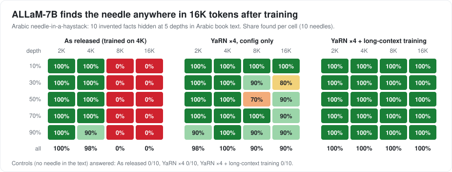

# allam-plus

Upgrading HUMAIN's open **ALLaM-7B-Instruct** for real Arabic applications, on one 16 GB gaming GPU, with every
change measured against the untouched model:

1. **Long context**: 4K → 16K tokens (YaRN + a short long-text training stage).
2. **Arabic tool calling**: general tools, Modern Standard Arabic and Saudi dialect.
3. **Agent-ready serving**: an OpenAI-compatible server that returns standard `tool_calls` (LangGraph and others).
4. **Fast quantised releases**: GGUF 4/8-bit with a speed and memory table.
5. **No loss of Arabic quality**: ArabicMMLU and Arabic IFEval before and after.

**Status:** Phase 1 (baselines) and Phase 2 (long context) done. **ALLaM-7B now reads 16K tokens (4× its original
4K) with no loss on short Arabic tasks**, trained in 2 h 19 min on one RTX 5080.

| | As released | + YaRN only | **allam-plus (Phase 2)** |
|---|---|---|---|
| Needle at 16K tokens | 0% | 90% | **100%** |
| LC-Eval (HUMAIN), multiple choice on 8–16K-token books | 18.3% | 47.8% | **63.8%** |
| ArabicMMLU | 68.6% | 67.2% | **68.8%** |
| Arabic IFEval | 40.8% | 42.1% | **40.3%** (no significant change) |

Details: [baselines](docs/BASELINES.md) · [long-context stage](docs/PHASE2.md)

Decisions and reasons: [docs/DECISIONS.md](docs/DECISIONS.md) · Learning log: [LEARNING.md](LEARNING.md) ·
Terms: [GLOSSARY.md](GLOSSARY.md)

Builds on [mujawib-receptionist-finetune](https://github.com/bn-basel/mujawib-receptionist-finetune) (ALLaM-7B and
Gemma-4-12B fine-tuned as Saudi-dialect receptionists with tool calling).
