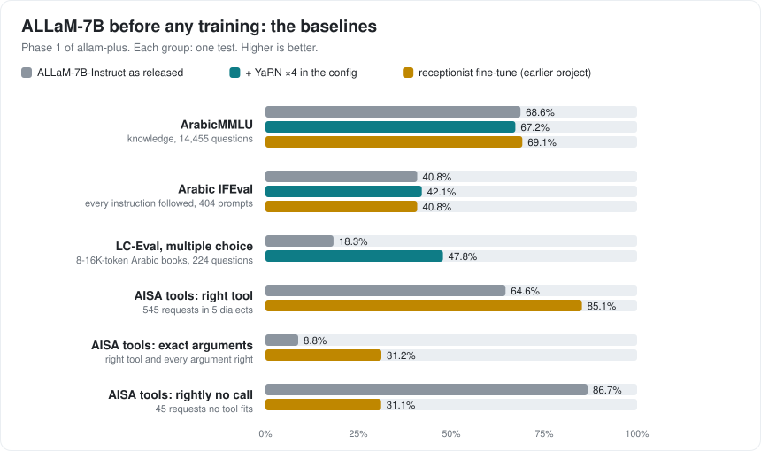
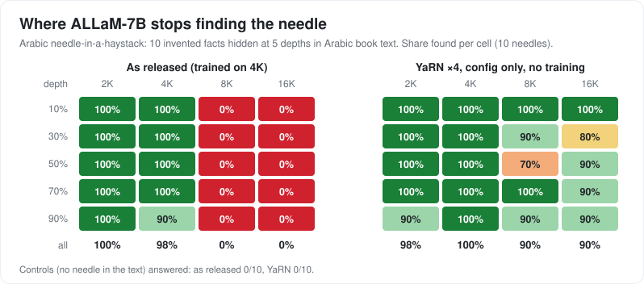
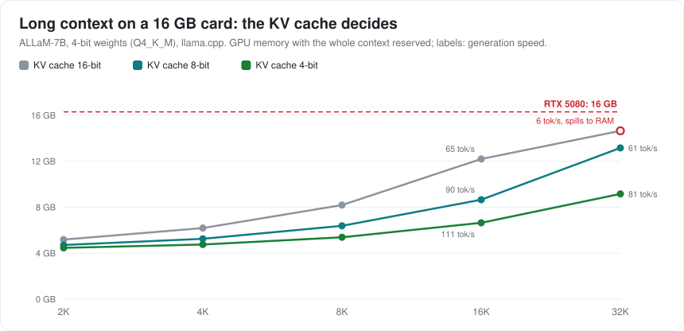

# Phase 1: baselines (no training)

Model: `humain-ai/ALLaM-7B-Instruct-preview`, measured 7 October 2026 on one RTX 5080 (16 GB). Three versions:
**as released**; **+ YaRN ×4** (position scaling switched on in the config, nothing trained); and the
**receptionist fine-tune** from the earlier project (`allam-7b-saudi-receptionist`), as a comparison row.
Greedy decoding everywhere. Methods and reasons: [DECISIONS.md](DECISIONS.md).

## Long context

| | 2K | 4K | 8K | 16K |
|---|---|---|---|---|
| Needle, as released | 100% | 98% | 0% | 0% |
| Needle, + YaRN ×4 | 98% | 100% | 90% | 90% |

Needle test: 10 invented Arabic facts × 5 depths per length (200 cases per version), haystack from LC-Eval's Arabic
book texts; 10 no-needle controls at 2K: neither version guessed (0/10).

| LC-Eval, Arabic, contexts ≤16K tokens (nearly all 8–16K) | As released | + YaRN ×4 |
|---|---|---|
| Multiple choice, 224 questions (options shuffled, chance 25%) | 18.3% | **47.8%** |
| Claim verification, 355 claims: balanced accuracy (chance 50%) | 51.8% | 52.1% |

Finding a fact at 16K (needle, 90%) is much easier than understanding a 16K book (multiple choice, 48%). Claim
verification is at chance for both versions (each leans to one answer: 81% "true" as released, 78% "false" with
YaRN), so it is reported but not used as a target.

## Arabic quality ("no loss" check)

| | As released | + YaRN ×4 | Receptionist |
|---|---|---|---|
| ArabicMMLU, 14,455 questions, 0-shot (model card: 67.78) | **68.6%** (67.9–69.4) | 67.2% (66.5–68.0) | 69.1% |
| Arabic IFEval, every instruction followed (404 prompts) | 40.8% | 42.1% | 40.8% |
| Arabic IFEval, single instructions followed | 49.2% | 52.7% | 51.1% |

- YaRN in the config costs **1.4 points on ArabicMMLU** (paired: 676 questions lost, 476 gained, p < 0.001), most in
  Language (−3.0) and Humanities (−1.9). Static YaRN changes positions for short texts too.
- On IFEval YaRN makes no significant difference (46 prompts gained, 41 lost, p = 0.67).
- The receptionist fine-tune did not hurt general Arabic: ArabicMMLU 69.1% vs 68.6%, IFEval equal.
- IFEval replies come from the 8-bit GGUF in llama.cpp (see D8b); 66 of 404 base replies repeat until the 1,280-token
  limit under greedy decoding (receptionist: 28).

## Tool calling

| AISA-ArabicFC dev, 545 requests, 5 dialects | As released | Receptionist |
|---|---|---|
| Right tool, or rightly none | 64.6% (60.5–68.5) | **85.1%** (81.9–87.9) |
| Right tool and every argument right | 8.8% | 31.2% |
| Rightly no call (45 requests no tool fits) | **86.7%** | 31.1% |
| Called a tool at all | 67.0% | 97.6% |
| Right tool, Gulf dialect only (75) | 65.3% | 80.0% |

- The base model's typical mistake: it copies the tool's schema into the arguments
  (`"arguments": {"properties": {"city": ...}}`) instead of filling in values.
- The receptionist model learned to call tools in general (6 tools in training, 27 here), but calls one almost every
  time, even when none fits. General tool training needs plenty of "no tool fits" cases.
- Receptionist test v2 (earlier project, 160 cases): as released 40.0% (1 tool call), receptionist 87.5%.
- ArabFuncBench: not yet run (gated dataset, waiting for access).

## Speed and memory (llama.cpp, whole context reserved)

| 4-bit weights (Q4_K_M, 4.0 GB) | KV 16-bit | KV 8-bit | KV 4-bit |
|---|---|---|---|
| 4K: GPU memory, generation speed | 6.3 GB, 123 tok/s | 5.4 GB, 137 tok/s | 4.9 GB, 149 tok/s |
| 16K | 12.5 GB, 65 tok/s | 8.9 GB, 90 tok/s | 6.8 GB, 111 tok/s |
| 32K | does not fit (6 tok/s) | 13.5 GB, 61 tok/s | 9.4 GB, 81 tok/s |

8-bit weights (Q8_0, 6.9 GB): 16K fits only with an 8-bit KV cache (11.8 GB, 69 tok/s); 32K does not fit.
Prompt reading (prefill) runs at ~4,400–8,000 tokens/s up to 16K.

## Training memory (QLoRA rank 16, YaRN ×4, gradient checkpointing, batch 1)

| Example length | Standard loss | Chunked loss | Chunked loss + activations in system RAM |
|---|---|---|---|
| 4K | 9.0 GB, 3.4 s/step | | |
| 8K | 13.3 GB, 10 s/step | 10.3 GB, 8 s/step | |
| 12K | 17.5 GB (spills), 15 s/step | 13.1 GB, 14 s/step | 10.3 GB, 14 s/step |
| 16K | 21.8 GB (spills), 33 s/step | 16.0 GB (spills), 659 s/step | **12.1 GB, 21 s/step** |

"Spills": more than the card's memory, so Windows moves the rest to system RAM and the step becomes very slow.
With the chunked loss and activation offloading, **16K-token examples train on this card**.

## Tool-calling starting points for Phase 3 (measured 2026-10-11)

ArabFuncBench (1,000 native-MSA cases; published by its authors with their own JSON prompt: Llama-3.x 99.7% (the file does not say 8B or 70B), Qwen2.5-7B-Instruct 99.2%, a commercial API model 92.4%, Fanar-9B 87.1%, AceGPT-7B 22.4% right
tool, no ALLaM row) and our formats. "Right tool" = their TSA; "argument match" = their AEF1.

| Model and prompt | Right tool | Argument match | Rightly no call | Calls a tool |
|---|---|---|---|---|
| ALLaM base, the paper's JSON prompt | 85.2% | 0.81 | 30% | 94% |
| ALLaM base, earlier English tool guide | 93.6% | 0.79 | 96% | 76% |
| ALLaM base, new Arabic tool guide (Phase 3 format) | 65.9% | 0.72 | 94% | 50% |
| Phase 2 model, new Arabic tool guide | 51.6% | 0.75 | 99.5% | 33% |
| Receptionist model, its own format | 78.4% | 0.84 | 22% | 98% |

| New Arabic tool format | AISA right tool | AISA exact arguments | Receptionist test v2 |
|---|---|---|---|
| ALLaM base | 68.8% | 10.8% | 36.3% |
| Phase 2 model | 78.5% | 2.0% | 39.4% |
| Receptionist model (its own format, earlier project) | 85.1% | 31.2% | 87.5% |

With the Arabic guide, untrained ALLaM calls tools far less often than with the earlier English one (50% vs 76% of
ArabFuncBench cases), so its score in the new format starts lower. Phase 3 trains the Arabic format directly; both
columns are reported. (The paper-prompt run is missing 1 of 1,000 cases after an interrupted run.)
