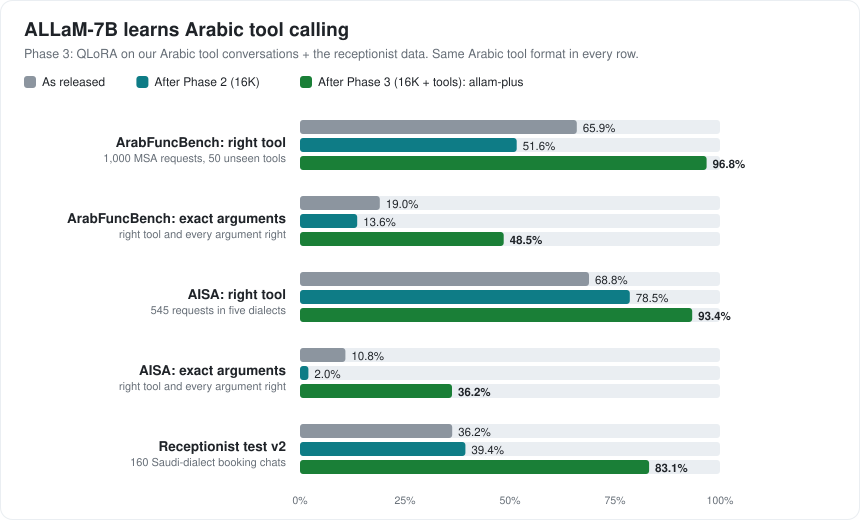

# Phase 3: Arabic tool calling

One QLoRA run on one RTX 5080, continuing the Phase 2 adapter: `runs/tools_v1`, checkpoint 400 (chosen on the dev set by
the rule fixed before training, [DECISIONS.md](DECISIONS.md) D16). YaRN ×4 stays on, so the model keeps its 16K context.
Every row below uses the same Arabic tool format ([scripts/toolformat.py](../scripts/toolformat.py)).

| Test | Target | As released | After Phase 2 | **After Phase 3** |
|---|---|---|---|---|
| ArabFuncBench, right tool (1,000 MSA requests) | above base | 65.9% | 51.6% | **96.8%** (95.5–97.7) |
| ArabFuncBench, every argument right | | 19.0% | 13.6% | **48.5%** |
| ArabFuncBench, argument match (AEF1) / Arabic values (LCR) | | 0.72 / 0.83 | 0.75 / 0.92 | **0.75 / 0.97** |
| ArabFuncBench, rightly no call (200 cases) | | 94% | 99.5% | **100%** |
| AISA-ArabicFC dev, right tool (545, five dialects) | above base | 68.8% | 78.5% | **93.4%** (91.0–95.2) |
| AISA, every argument right | | 10.8% | 2.0% | **36.2%** |
| AISA, Gulf dialect: right tool / every argument right | | 65.3% / 11.1% | | **90.7% / 36.1%** |
| Receptionist test v2 (160 Saudi-dialect cases) | ≥ 85% | 36.3% | 39.4% | **83.1%** (76.6–88.1) |

Kept from Phase 2 (same tests, same settings):

| Test | Limit | After Phase 2 | **After Phase 3** |
|---|---|---|---|
| Needle, every length 2K–16K (200 cases) | 16K ≥ 98% | 100% | **100%** |
| LC-Eval multiple choice, 8–16K-token books | ≥ 60% | 63.8% | **64.7%** |
| ArabicMMLU (as released: 68.6%) | ≥ 67.6% | 68.8% | **69.2%** |
| Arabic IFEval, every instruction followed (as released: 40.8%) | not lower | 40.3% | **42.3%** |

Paired tests: ArabicMMLU vs as released, 618 questions gained and 539 lost (p = 0.02, a small real gain); IFEval vs as
released, 36 gained and 30 lost (p = 0.54); LC-Eval vs Phase 2, 11 gained and 9 lost (p = 0.82).

## The one target missed: the receptionist test

83.1% against a target of 85% (136 of 160 would have been 85%). The receptionist-only model from the earlier project
scores 87.5%; on the same cases the new model wins 8 and loses 15 (p = 0.21), so the gap is within noise but leans one
way. Where it loses: it answers in text where a tool call was expected (14 cases, mostly bookings and the unseen
reschedule tool), and for questions the business cannot answer it searches the services list instead of handing over
to a person (5). Invented facts stay as low as before (3 vs 2). This is the measured cost of a general model against
one trained for this single job.

## Compared with the published ArabFuncBench results

The benchmark's authors published Llama-3.x 99.7% and Qwen2.5-7B-Instruct 99.2% right tool (argument match 0.91 and
0.83), a commercial API model 92.4%, Fanar-9B 87.1% and AceGPT-7B 22.4%, with their own JSON prompt and sampling at
temperature 0.1 (argument match: Llama 0.91, Qwen 0.83, Fanar 0.86). allam-plus: 96.8% and 0.75 in our format, greedy.
So ALLaM now picks the right tool more often than Fanar-9B and the API model, but fills in arguments less well than
Fanar-9B and the best general open 7–8B models: argument extraction is the clearest place to improve next.

## How it was trained

| | |
|---|---|
| Data | 2,624 general tool conversations (our DeepSeek pipeline, 102 tools in 18 domains, seven scenarios, MSA and Saudi), 1,095 receptionist conversations, Phase 2 replay (150 long chats, 30 long articles, 400 short answers) |
| Generation cost | $0.64 for 3,184 conversations (2,733 passed every check) and $0.01 for the tool library |
| Tokens | 6.16 M seen, 0.93 M trained on |
| Settings | continues the Phase 2 adapter; lr 1e-4 (cosine), 8 examples per step, 537 steps, YaRN ×4 |
| Time and memory | 2 h 22 min, peak 12.0 GB |

Dev set (167 held-out conversations, 530 assistant turns):

| | all turns right | turns that call a tool | turns that reply in text |
|---|---|---|---|
| Start (Phase 2 model) | 61.5% | 7.9% | 97.8% |
| checkpoint 100 | 69.6% | 57.0% | 78.2% |
| checkpoint 200 | 79.2% | 57.9% | 93.7% |
| checkpoint 300 | 78.9% | 59.4% | 92.1% |
| **checkpoint 400** | **80.9%** | **63.1%** | 93.0% |
| checkpoint 500 | 80.0% | 61.7% | 92.4% |
| checkpoint 537 | 80.4% | 62.6% | 92.4% |

## Release files (local, not yet published)

`C:\WIP\release-work\allam-plus-tools_v1\gguf\`: Q8_0 (7.4 GB) and Q4_K_M (4.3 GB), adapter merged into all 224
linear weights. IFEval above ran on the Q8_0 file with YaRN set on the llama-server command line. Phase 4 adds the
chat template that makes llama-server return standard `tool_calls`.

## The receptionist tuning round (tools_v2): the release model

To close the gap, a short second run continued checkpoint 400 on a second pass over the receptionist conversations
plus enough general tool and Phase 2 examples not to forget the rest (1,915 examples, half the learning rate, 239
steps, 58 min). The rules for choosing a checkpoint and for replacing tools_v1 were written before training
([DECISIONS.md](DECISIONS.md) D19); checkpoint 180 met all of them (D21).

| Test (same cases) | tools_v1 | **tools_v2** | gained / lost |
|---|---|---|---|
| Receptionist test v2 | 83.1% | **85.0%** | 13 / 10 |
| ArabFuncBench, right tool | 96.8% | 96.0% | 3 / 11 |
| AISA, right tool | 93.4% | 92.7% | 7 / 11 |
| Needle at 16K | 100% | 100% | 0 / 0 |
| LC-Eval multiple choice | 64.7% | 66.1% | 5 / 2 |
| ArabicMMLU | 69.2% | 69.2% | 148 / 139 |
| Arabic IFEval | 42.3% | 41.3% | 17 / 21 |

None of the differences is statistically clear (the closest: ArabFuncBench, p = 0.06). tools_v2 reaches the 85%
target by the smallest margin and is the release model by the rule; in practice the two are at the same level.
