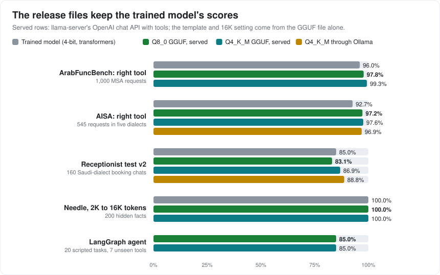

# Phase 4: serving and release

The goal: an app or agent sends a standard OpenAI-style request (messages and `tools`) to a local server and gets
standard `tool_calls` back, with the model reading exactly what it was trained on. The release model is tools_v2
checkpoint 180 (the receptionist tuning round, [DECISIONS.md](DECISIONS.md) D19 and D21). Decisions and fixes: D20, D22.



## How a request reaches the model

```
app / LangGraph ──OpenAI request──▶ llama-server ──chat template (inside the GGUF)──▶ prompt text ──tokenizer──▶ ALLaM
      ▲                                                                                                   │
      └──────────── standard tool_calls ◀── tool-call parser (+ grammar from the tool schemas) ◀── <tool_call> lines
```

| Piece | What we did | Check |
|---|---|---|
| Chat template | `release/chat_template.jinja`, written from the same guide as training (`scripts/make_template.py`) | identical text to training on 16,224 prompts (transformers) and 12,011 of 12,013 (llama-server; the 2: a past call's `250.0` comes back as `250`), for both release files |
| Tokenizer | GGUF flag `add_space_prefix = false` (llama.cpp otherwise adds a space token after every `<s>`) | token ids identical in 300 of 300 sampled prompts (0 of 300 without the flag) |
| Tool-call parser | llama-server's own, found from the template: no proxy | standard `tool_calls`; arguments sent as JSON strings give the same prompt |
| 16K context | YaRN ×4 stored in the GGUF (`scripts/finalize_gguf.py`): no command-line flags | needle through the chat API: 200 of 200, 2K to 16K, both files |

## Served results (what an app gets)

Every served row sends the real OpenAI request to llama-server (or Ollama) with nothing but the GGUF file; greedy.

| Test | Trained model (4-bit, transformers) | Q8_0 served | Q4_K_M served | Q4_K_M through Ollama |
|---|---|---|---|---|
| ArabFuncBench, right tool / every argument right | 96.0% / 47.6% | **97.8%** / 45.1% | **99.3%** / 48.0% | |
| AISA-ArabicFC dev, right tool / every argument right | 92.7% / 31.6% | **97.2%** / 29.8% | **97.6%** / 34.2% | 96.9% / 28.6% |
| Receptionist test v2 | 85.0% | 83.1% | 86.9% | 88.8% |
| Needle, 2K–16K (200 cases) | 100% | 100% | 100% | |
| LangGraph agent, 20 tasks on unseen tools | | 17 / 20 | 17 / 20 | |

Choosing the right tool is *better* when served: once the model starts a call, llama-server's grammar lets it write
only a tool name that exists (and JSON that fits the schema). Arguments do not gain: the grammar checks their shape, not
their values. The receptionist scores differ by a few cases either way, within noise for 160 cases.

## LangGraph agent

[`demo/agent.py`](../demo/agent.py): the usual tool loop as a LangGraph graph (`model → tools → model → … → END`),
LangChain's `ChatOpenAI` pointed at llama-server. Seven tools in three areas the model never saw in training (car
servicing, gold and currency prices, parcel shipping) with a fixed fake backend, and 20 scripted tasks
([`demo/tasks.json`](../demo/tasks.json)).

| Kind of task | Q8_0 | Q4_K_M |
|---|---|---|
| One call (7) | 7 | 7 |
| Two calls at once (2) | 2 | 2 |
| No tool fits: answer or decline (3) | 3 | 3 |
| Tool returns an error: tell the user, invent nothing (2) | 2 | 2 |
| A result feeding the next call (2) | 1 | 1 |
| A detail is missing: ask for it (2) | 1 | 1 |
| Follow-up turn (2) | 1 | 1 |

The three failures, the same in both files, show where the model is still weak:
- **Chained calls:** asked for a shipping cost *and* that cost in dollars, it called both tools at once instead of
  waiting for the cost, and converted the weight (2) instead of the price (37).
- **Missing detail:** asked to book a check-up with no date or time, it booked one anyway, for a date and time it made
  up. In a real booking app the app should check required details itself before running a booking tool.
- **Arithmetic on an earlier result:** asked for the price of 5 grams after getting the price per gram, it tried to
  do the multiplication with the currency tool.

```
uv run python demo/agent.py --server http://127.0.0.1:8095 --chat
```

## Speed and memory (RTX 5080, llama.cpp b11457)

GPU memory with the whole context reserved; prompt reading and writing speed after that much context (llama-bench).

| File | Context | KV cache | GPU memory | Reading (tokens/s) | Writing (tokens/s) |
|---|---|---|---|---|---|
| Q4_K_M (4.3 GB) | 4K | 16-bit | 6.2 GB | 7,587 | 123 |
| Q4_K_M | 4K | 8-bit | 5.3 GB | 7,173 | 138 |
| Q4_K_M | 16K | 16-bit | 12.2 GB | 4,808 | 62 |
| Q4_K_M | 16K | 8-bit | **8.6 GB** | 4,365 | 90 |
| Q8_0 (7.4 GB) | 4K | 16-bit | 9.0 GB | 7,947 | 87 |
| Q8_0 | 4K | 8-bit | 8.1 GB | 7,509 | 95 |
| Q8_0 | 16K | 16-bit | 14.9 GB | 848 (spills to RAM) | 38 |
| Q8_0 | 16K | 8-bit | 11.5 GB | 4,489 | 69 |

For the full 16K on a 16 GB card: Q4_K_M with either cache, or Q8_0 with the 8-bit cache (`-ctk q8_0 -ctv q8_0`).
On a 12 GB card: Q4_K_M with the 8-bit cache.

## Ollama

| Route | Tool calls | Receptionist v2 | AISA right tool |
|---|---|---|---|
| `release/Modelfile` (Ollama 0.40+: the template inside the GGUF) | standard `tool_calls` | 88.8% | 96.9% |
| `release/Modelfile.go-template` (older Ollama, or `OLLAMA_GO_TEMPLATE=1`) | left in the reply text; parse `<tool_call>` lines yourself | 78.8% | 96.7% |

The Go template cannot print the tool list exactly as in training (Go writes compact JSON in its own key order); that
costs about 10 points on the receptionist test. Use Ollama 0.40 or later.

## Release files

`allam-plus-7b-Q8_0.gguf` (7.4 GB) and `allam-plus-7b-Q4_K_M.gguf` (4.3 GB): tools_v2 checkpoint 180 merged into
ALLaM-7B-Instruct, with the template and the 16K setting inside. Not published yet.

```
llama-server -m allam-plus-7b-Q4_K_M.gguf -ngl 99 -c 16384 -ctk q8_0 -ctv q8_0 -fa on --jinja --port 8095
```
