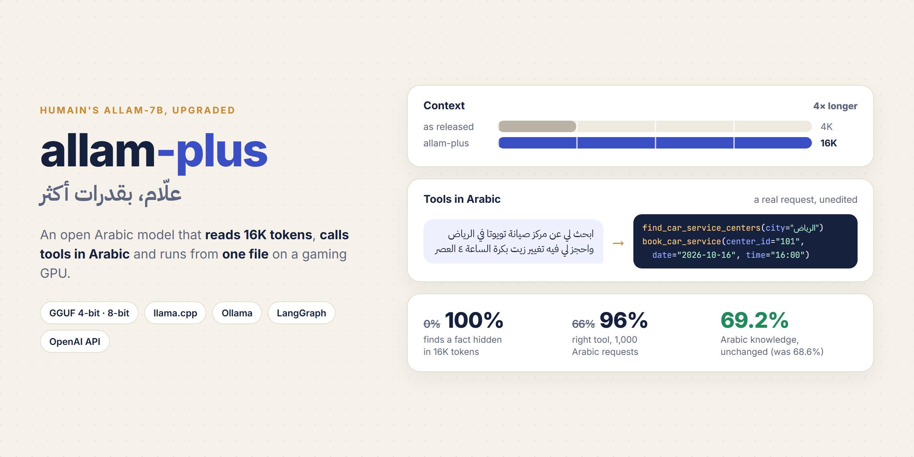
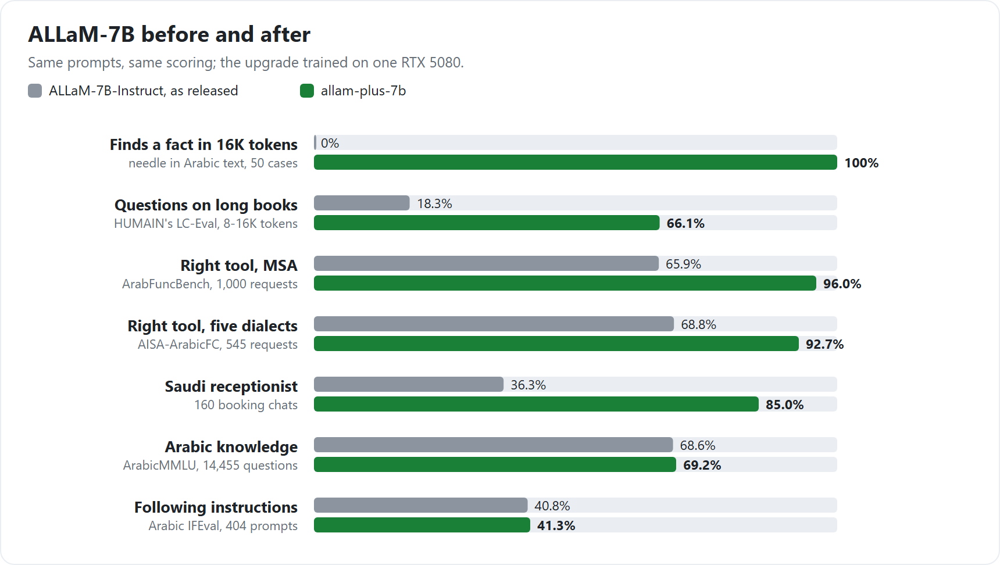
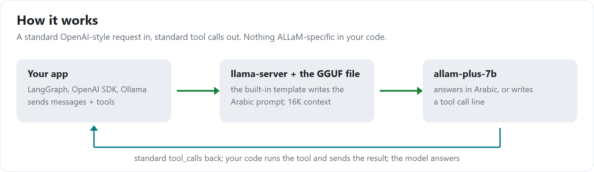
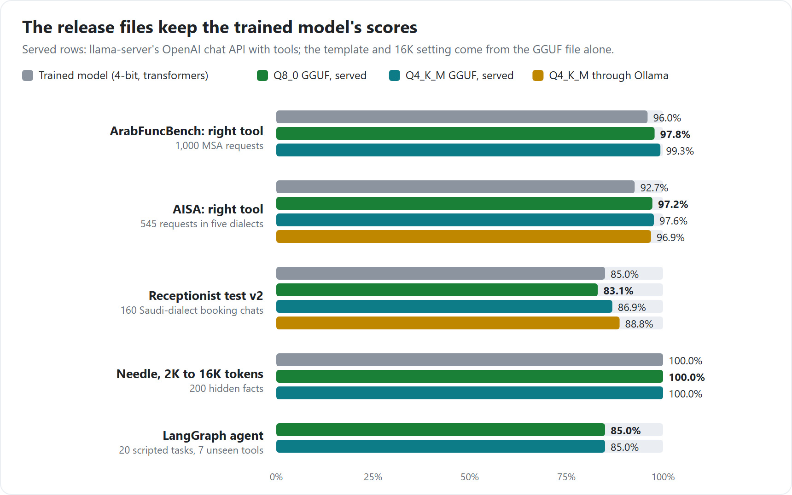
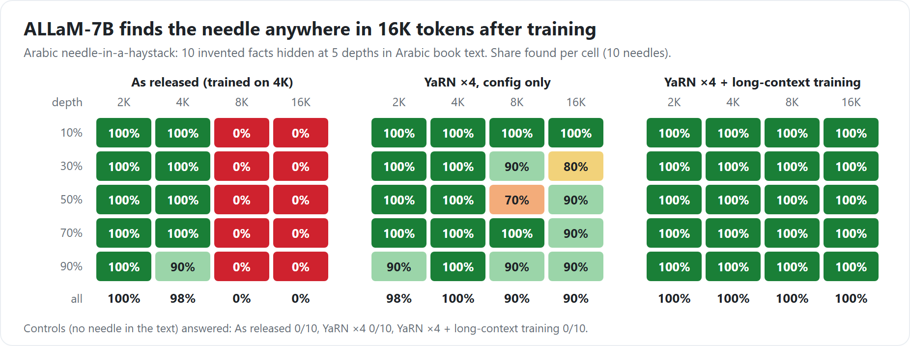

# allam-plus-7b

HUMAIN's open Arabic model [ALLaM-7B-Instruct](https://huggingface.co/humain-ai/ALLaM-7B-Instruct-preview), upgraded
on one gaming GPU (RTX 5080):

- **Reads 4× more:** 16K tokens instead of 4K.
- **Uses tools in Arabic:** books, looks up and checks things, in Modern Standard Arabic and Saudi dialect.
- **Plugs into standard apps:** this GGUF file gives an OpenAI-style server with standard `tool_calls`
  (llama.cpp, Ollama, LangGraph, the OpenAI SDK).
- **Lost nothing:** general Arabic knowledge and instruction following stay the same.

Built by **Basel**, a CS/AI student at the University of Melbourne and the founder of Mujawib. Code, data recipes and
every result: [GitHub](https://github.com/bn-basel/allam-plus).





<details>
<summary><b>The numbers as a table</b></summary>

| | ALLaM-7B-Instruct as released | **allam-plus-7b** |
|---|---|---|
| Needle in 16K tokens of Arabic text | 0% | **100%** |
| LC-Eval (HUMAIN), multiple choice on 8–16K-token Arabic books | 18.3% | **66.1%** |
| ArabFuncBench (MSA), right tool / every argument right | 65.9% / 19.0% | **96.0% / 47.6%** |
| AISA-ArabicFC dev (five dialects), right tool / every argument right | 68.8% / 10.8% | **92.7% / 31.6%** |
| Saudi-dialect receptionist test (160 cases) | 36.3% | **85.0%** |
| ArabicMMLU (14,455 questions) | 68.6% | **69.2%** |
| Arabic IFEval, every instruction followed | 40.8% | **41.3%** |

Same prompt format in both columns; greedy decoding.
</details>

## Use it

| File | Size | For |
|---|---|---|
| `allam-plus-7b-Q4_K_M.gguf` | 4.3 GB | most GPUs; 16K context in 8.6 GB with an 8-bit KV cache |
| `allam-plus-7b-Q8_0.gguf` | 7.4 GB | best quality; use the 8-bit KV cache at 16K on a 16 GB card |

```bash
llama-server -m allam-plus-7b-Q4_K_M.gguf -ngl 99 -c 16384 -ctk q8_0 -ctv q8_0 -fa on --jinja --port 8095
```

```python
from openai import OpenAI

client = OpenAI(base_url="http://127.0.0.1:8095/v1", api_key="local")
tools = [{"type": "function", "function": {
    "name": "get_gold_price", "description": "سعر غرام الذهب اليوم بالريال السعودي.",
    "parameters": {"type": "object", "properties": {"karat": {"type": "integer"}}, "required": ["karat"]}}}]
r = client.chat.completions.create(model="allam-plus", temperature=0, tools=tools,
                                   messages=[{"role": "user", "content": "كم سعر غرام الذهب عيار ٢١؟"}])
print(r.choices[0].message.tool_calls)   # get_gold_price {"karat": 21}
```

Ollama 0.40 or later: `ollama create allam-plus -f Modelfile`, then use its chat API with `tools`.

<details>
<summary><b>Transformers + PEFT (the adapter)</b></summary>

The adapter in `adapter/` goes on top of the original model with YaRN ×4 set in its config (as in training; the
model was trained and tested in 4-bit NF4, as below):

```python
import torch
from huggingface_hub import hf_hub_download
from peft import PeftModel
from transformers import AutoConfig, AutoModelForCausalLM, AutoTokenizer, BitsAndBytesConfig

base = "humain-ai/ALLaM-7B-Instruct-preview"
config = AutoConfig.from_pretrained(base)
config.rope_parameters = {"rope_theta": 1e6, "rope_type": "yarn", "factor": 4.0, "original_max_position_embeddings": 4096}
config.max_position_embeddings = 16384
tok = AutoTokenizer.from_pretrained(base)
tok.chat_template = open(hf_hub_download("bnbasel/allam-plus-7b", "chat_template.jinja"), encoding="utf-8").read()
model = AutoModelForCausalLM.from_pretrained(
    base, config=config, device_map="auto", dtype=torch.bfloat16,
    quantization_config=BitsAndBytesConfig(load_in_4bit=True, bnb_4bit_quant_type="nf4", bnb_4bit_use_double_quant=True,
                                           bnb_4bit_compute_dtype=torch.bfloat16))
model = PeftModel.from_pretrained(model, "bnbasel/allam-plus-7b", subfolder="adapter")

prompt = tok.apply_chat_template(messages, tools=tools, add_generation_prompt=True, tokenize=False)
# the reply holds <tool_call>{"name": ..., "arguments": {...}}</tool_call> lines for any tool calls
```
</details>

The 16K setting (YaRN ×4) and the chat template are stored in the GGUF files, so no extra flags are needed.
Write tool names in English and descriptions in Arabic or English; the model sees the tools after a short Arabic guide
and answers with one `<tool_call>{"name": ..., "arguments": {...}}</tool_call>` line per call, which the server turns
into `tool_calls`.

## The files, tested the way apps use them

Each file was run through llama-server's chat API with nothing but the file itself. Choosing a tool is even better
than in training, because the server only lets the model write tool names that exist.



| File | Context | KV cache | GPU memory | Writing speed |
|---|---|---|---|---|
| Q4_K_M | 16K | 8-bit | 8.6 GB | 90 tokens/s |
| Q4_K_M | 4K | 16-bit | 6.2 GB | 123 tokens/s |
| Q8_0 | 16K | 8-bit | 11.5 GB | 69 tokens/s |

RTX 5080, llama.cpp b11457.

## Long context

The original model stops working past 4,096 tokens. After the upgrade it finds a fact hidden anywhere in 16K tokens
of Arabic text.



## How it was built

1. **Baselines first.** Needle-in-a-haystack in Arabic, LC-Eval, ArabicMMLU, Arabic IFEval, ArabFuncBench, AISA and a
   Saudi-dialect receptionist test, all run on the untouched model before any training.
2. **Long context.** YaRN position scaling ×4, then QLoRA on 16K-token Arabic examples the model wrote itself from
   Wikipedia (questions about long texts) plus its own short answers as replay, so short-text behaviour stays the same.
   Training at 16K on 16 GB took chunked loss and activation offloading.
3. **Tool calling.** 2,624 general tool conversations (102 tools in 18 everyday domains; MSA and Saudi users; one call,
   parallel calls, chained calls, missing details, tool errors, no tool fits) from our own rule-driven generation
   pipeline built on DeepSeek V4.1 Flash, every conversation checked by rules; plus 1,095 receptionist conversations
   and replay from step 2. Then a short second pass weighted towards the receptionist conversations. Checkpoints were
   chosen by rules fixed before training.
4. **Serving.** A chat template that writes exactly the training prompt from a standard OpenAI request (checked on
   16,224 prompts), a tokenizer setting so llama.cpp produces the same tokens as training, and the 16K setting inside
   the GGUF. The release files were re-tested through the chat API, through Ollama and in a LangGraph agent.

## Limits

- **Chained calls, missing details, arithmetic:** on a 90-task LangGraph test with tools it never saw, it passed all 30
  ordinary tasks (one call, two calls at once, no tool fits, tool errors, follow-ups) but only 7 of 20 where a second
  call needs the first one's result, 7 of 20 where a required detail is missing (it often makes one up instead of
  asking), and 5 of 20 that need arithmetic on tool results. Check required arguments in your app before running a
  tool that changes something, and do sums in code.
- **Arguments:** it picks the right tool far more often than it fills every argument exactly right (about half on
  ArabFuncBench), mostly small differences in how a value is written.
- Most tests are synthetic or translated; the receptionist test was written for the earlier project. Real users write
  with more variety.
- 16K is the trained length; longer inputs are not supported.

**Licence:** Apache-2.0, as the base model.
